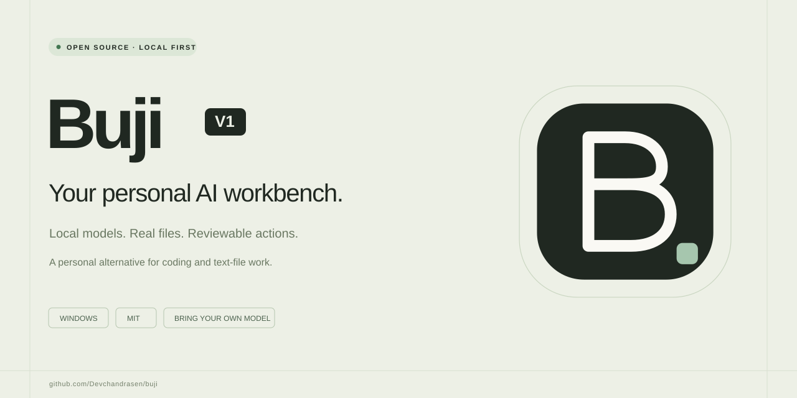
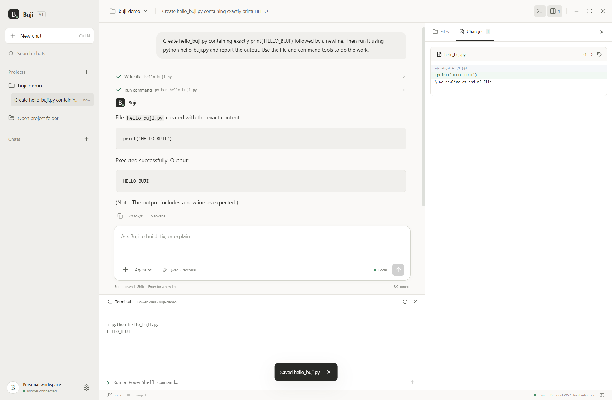
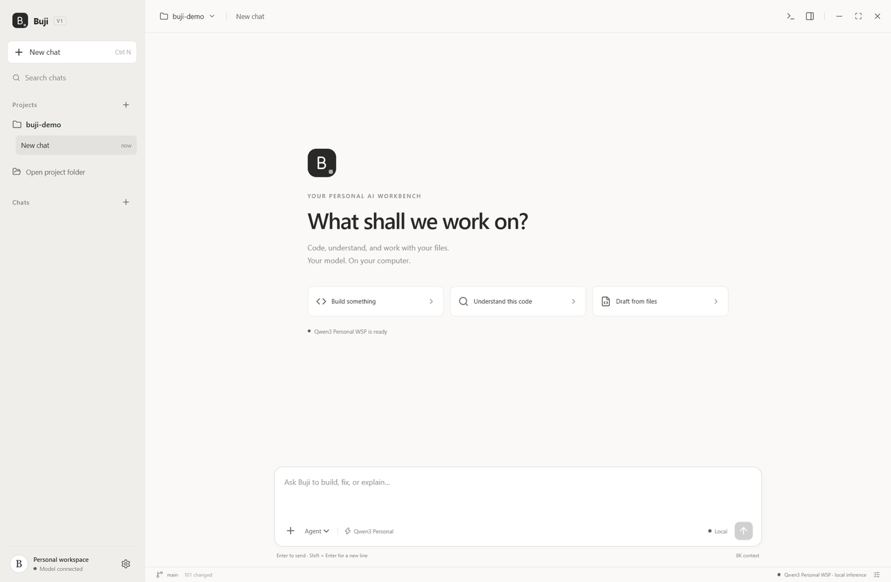
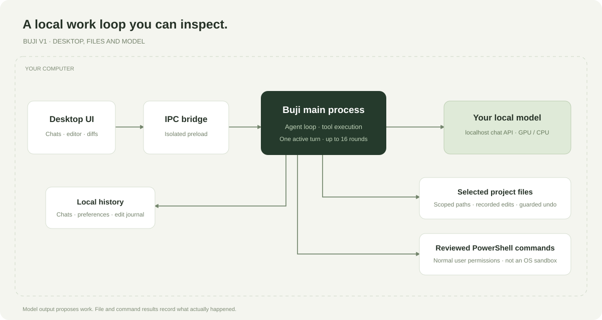

<p align="center">
  
</p>

<p align="center">
  <a href="https://github.com/Devchandrasen/buji/releases/latest"></a>
  <a href="LICENSE"></a>
  <a href="https://github.com/Devchandrasen/buji/actions/workflows/ci.yml"></a>
  
</p>

<p align="center">
  <strong>An open-source, local-first personal alternative to Codex and Claude Cowork.</strong><br/>
  For coding and text-file work on Windows. Your projects, your conversations, your local model.
</p>

<p align="center">
  <a href="https://github.com/Devchandrasen/buji/releases/latest">Download</a> ·
  <a href="docs/QUICKSTART.md">Quick start</a> ·
  <a href="docs/MODELS.md">Connect a model</a> ·
  <a href="docs/ARCHITECTURE.md">Architecture</a> ·
  <a href="CONTRIBUTING.md">Contribute</a>
</p>

## Meet Buji

Buji brings a familiar project-and-chat workspace to a model running on your own computer. Give it a folder and a task. It can inspect text files, make real edits, propose a PowerShell command, and show the results in an editor and reviewable diff.

The application is MIT-licensed. A hosted AI account or subscription is not required to use Buji with an unauthenticated local model server. You provide the hardware and model.



## What V1 does

| Workflow | Included |
| --- | --- |
| Project-based conversations | Open folders, saved chats, search, rename, archive and restore |
| Coding agent | List, read, search, create and edit UTF-8 project files |
| File work | Draft Markdown, summarize source/text files, and build small utilities |
| Review | Before/after diffs and undo with external-change checks |
| Editor | Syntax highlighting, line numbers, and `Ctrl+S` |
| Commands | Non-interactive PowerShell with command review enabled by default |
| Vision | Image attachments when the connected model supports them |
| Personal workspace | Light/dark themes, local settings and local chat history |
| Local model connection | Configurable localhost OpenAI-compatible chat endpoint |

### A real workflow

The walkthrough below uses actual app captures from the integration test: the model creates a Python file, waits for command approval, runs it, and exposes the edit for review. Frame timing is edited for readability.



## Get started

### Windows download

1. Download **Buji-V1-Windows-x64.zip** from [Releases](https://github.com/Devchandrasen/buji/releases/latest).
2. Extract the complete folder and open **Start-Buji.cmd** or **app/Buji.exe**.
3. Connect a running local model in **Settings**, or select a PowerShell launcher for it.
4. Choose **Open project folder**. Use **Agent** mode to work with files, or **Chat** mode for conversation.

**Model setup is separate.** The download includes the desktop application, not multi-gigabyte model weights or an inference runtime. The [model guide](docs/MODELS.md) covers the tested Qwen profile, an existing local API, and an optional backend launcher.

The validated profile is **Qwen3 Personal WSP**, a custom Qwen3-VL-4B-Instruct Q4_K_M build with an F16 vision projector. Existing installations of that profile are detected automatically. Other model/server combinations need their own configuration and validation.

### Run from source

Requires Windows and Node.js 24. Git and Python are useful for project tasks; Python is not required just to open the app.

```powershell
git clone https://github.com/Devchandrasen/buji.git
cd buji
npm ci
npm run build
npm start
```

```powershell
npm test                 # Core checks, no GPU or model required
npm run test:desktop     # Real desktop + local-model checks
npm run package          # Build a portable Windows application
```

See [Contributing](CONTRIBUTING.md) for development and packaging details.

## Why a personal alternative?

Buji focuses on the **folder → conversation → action → review** workflow. [Codex](https://openai.com/index/introducing-the-codex-app/) describes a broader agent workspace for software development; [Claude Cowork](https://support.claude.com/en/articles/13345190-get-started-with-claude-cowork) describes multi-step work beyond coding. Buji offers a smaller, inspectable, self-hosted take on a subset of those workflows.

| If you want… | Buji V1 |
| --- | --- |
| A desktop interface for your own local model | Included |
| A visible record of file edits and commands | Included |
| Source you can inspect and modify | MIT-licensed |
| Cloud agents, parallel worktrees or remote task continuation | Outside V1 |
| Browser/computer automation, MCP connectors or app integrations | Outside V1 |
| Native editing of PDF, DOCX, XLSX or slide decks | Outside V1 |
| The reasoning capability of a frontier coding model | Depends on the model you connect; not established by this project |

Buji is an independent project and is not affiliated with OpenAI or Anthropic. “Alternative” describes the personal workflow and deployment choice, not feature parity or a model-quality benchmark.

## How it works



- The React renderer talks to a narrow Electron preload bridge.
- The main process handles persistence, the agent loop, workspace file tools and command execution.
- Chat context is sent to a localhost model endpoint; redirects are rejected.
- File tools check project boundaries, including junctions. PowerShell commands run with your Windows account's permissions after the configured review step.

The command runner is **not an OS sandbox**. See [Architecture](docs/ARCHITECTURE.md), [Privacy](docs/PRIVACY.md) and [Security](SECURITY.md) for the actual boundaries.

## Tested configuration and current limits

The original implementation was exercised with an RTX 5060 Laptop GPU (8 GB VRAM), about 16 GB system RAM, and the custom Qwen3-VL-4B profile. Its model plus vision projector occupy about 3.10 GiB; model weights are reused rather than copied into the app.

V1 uses an 8K context configuration in the tested backend and caps a turn at 16 tool rounds. Long model history is shortened while full conversation history stays stored locally. The terminal is a command runner rather than a full interactive PTY. Generated code still needs project-specific tests and review.

[Validation details](docs/VALIDATION.md) distinguish core checks, real-model desktop checks and model experiments. The optional [weight-space editing recipe](tools/model/README.md) documents the custom checkpoint without distributing its weights or claiming complete removal of model refusals.

## Project

- [Roadmap](ROADMAP.md) — planned work, clearly separated from shipped features
- [Changelog](CHANGELOG.md) — release history
- [Contributing](CONTRIBUTING.md) — development, tests and useful contributions
- [Security](SECURITY.md) — reporting and execution boundaries
- [Code of conduct](CODE_OF_CONDUCT.md) — community expectations
- [Third-party notices](THIRD_PARTY_NOTICES.md) — dependencies and upstream attribution

**License:** [MIT](LICENSE) for Buji's application code. Model weights and third-party software retain their own licenses.
