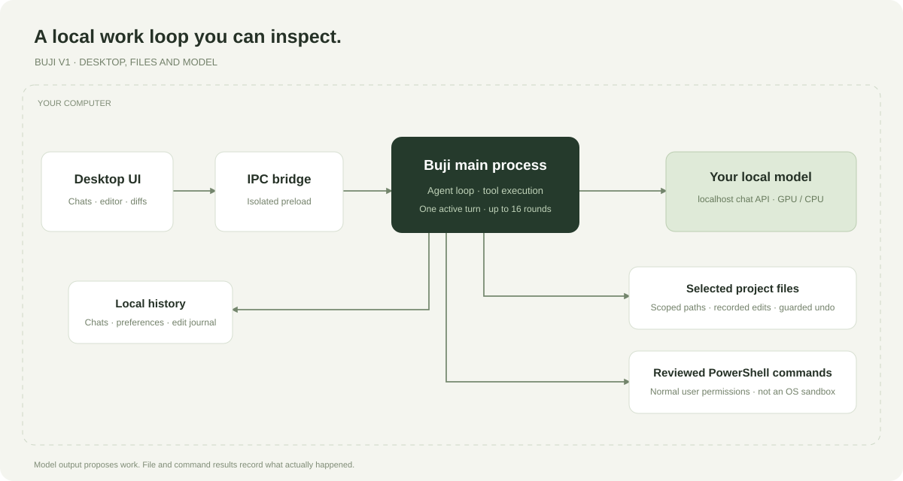
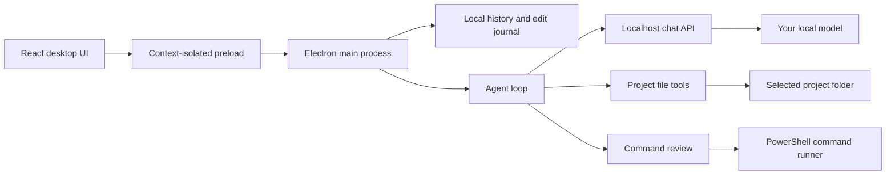

# Architecture

## Renderer and bridge

`src/renderer.jsx` renders projects, chat, model settings, the editor, diffs and command output. Markdown is rendered with HTML disabled. A content-security policy restricts renderer resources and network access.

`src/preload.cjs` exposes explicit operations through `window.buji`. It does not expose Node.js or unrestricted `ipcRenderer` access to the page. Main-process handlers validate the sending frame.

## Agent loop

`src/core/agent.cjs` constructs a task-specific system prompt, sends a compacted history to the local model, assembles streamed text/tool calls, executes supported tools, and feeds their real results back to the model.

Supported tools are `list_files`, `read_file`, `search_text`, `write_file`, `edit_file` and `run_command`. A turn has at most 16 rounds. There is one active agent reply at a time, matching the tested single-slot model backend.

`src/core/task.cjs` recognizes common English/Hinglish action requests and tracks per-turn file/command evidence. A recognized code-build request needs a write and a successful command after the most recent write. Premature prose is retried through native tool calling, at most twice; it is never parsed as shell/code to execute. A remaining unmet requirement produces an incomplete result. This request classifier is a heuristic, not a universal understanding of intent or proof that a test is sufficient.

A declined command ends action execution for that turn, including later calls from the same response. Execution summaries use recorded results rather than the model's completion claims. Chat mode remains a deliberate answer-only mode.

Tool output and files are described to the model as data. This instruction is not a proof of prompt-injection resistance; actual file/IPC checks and command review provide separate controls.

## Model transport

`src/core/model.cjs` validates localhost endpoints, rejects redirects and parses streaming chat completions. Native structured tool calls are preferred. A small fallback recognizes literal tool-call tags for compatible local templates.

Only complete historical tool-call groups are compacted. Long results can be shortened for model context; the stored conversation retains its original tool results.

## Files and undo

`src/core/workspace.cjs` resolves a selected project root and checks paths, including existing junction/symlink parents. File operations are limited to UTF-8 text smaller than 2 MiB. Large reads are bounded.

Writes record previous/new contents and hashes. Undo restores a recorded version only when the file still matches the written version. This prevents an old undo action from silently replacing a later external edit.

## Commands

`src/core/commands.cjs` starts non-interactive PowerShell with a project working directory, bounded output and a timeout. Cancellation terminates the owned child process tree.

The command review setting controls whether an agent command waits for a user decision. Commands have normal Windows user permissions and are not an OS sandbox. Manually entered terminal commands are explicit user actions.

## Persistence

`src/core/store.cjs` writes a local JSON database using a temporary file and rename. Recognized previous QwenDesk state can be copied on first launch; existing Buji state is not overwritten.

See [Privacy](PRIVACY.md) for what that database can contain.
